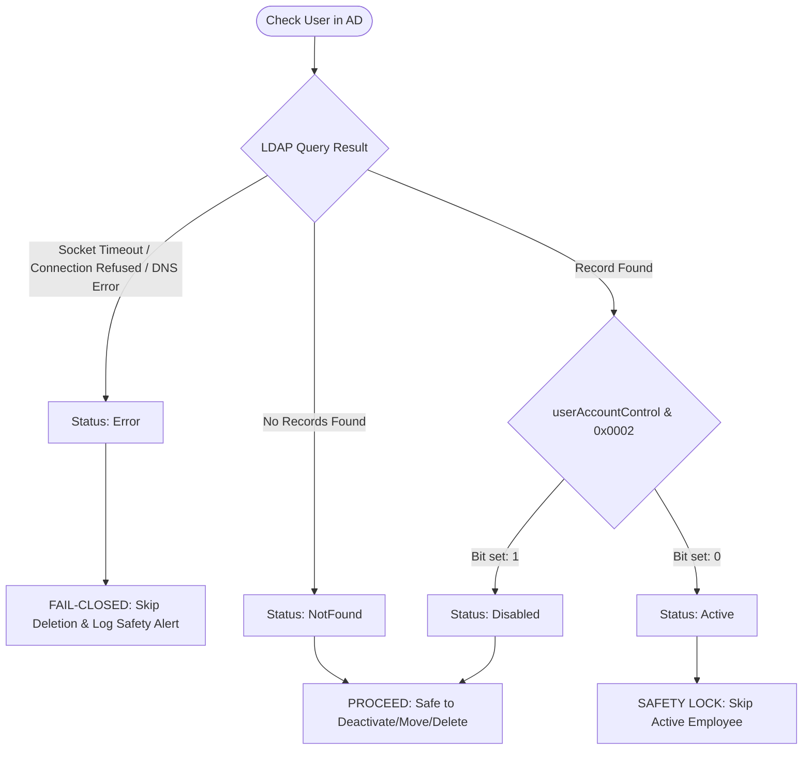

# Broadcom Symantec CloudSOC (Elastica) API & AD Technical Specification

This document provides coding agents with the exact, definitive API contracts, schemas, headers, rate-limiting behaviors, and LDAP correlation mechanisms for the Broadcom Symantec CloudSOC (Elastica) IAM platform. Agents should use these specifications directly without needing to inspect legacy PowerShell scripts.

---

## 1. CloudSOC API Authentication & HTTP Headers

All requests to the CloudSOC Admin REST API require HTTP Basic Authentication over HTTPS.

### Authentication Formula
```
Authorization = "Basic " + Base64( key_id + ":" + key_secret )
```

### Required Request Headers
```http
Authorization: Basic <base64-encoded-key-and-secret>
X-Elastica-Dbname-Resolved: True
User-Agent: PowerShell/5.1 (Windows NT 10.0; Browser/Script; SourceLocation/<local_ip>)
tenant: <tenant_id>
Content-Type: application/json
```

* **Target Base URL Structure:** `{api_server}/{tenant}/{endpoint}`
  * Example: `https://api-vip.elastica.net/hdaltonpcslabsorg/api/admin/v1/user_management/`
* **Enterprise SSL Inspection:** CloudSOC endpoints frequently sit behind enterprise SSL decoders (Symantec Web Gateway / BlueCoat). Python clients must use a tolerant SSL context (`check_hostname = False`, `verify_mode = CERT_NONE`) to prevent certificate chain rejections.

---

## 2. API Rate Limiting & Sliding-Window Quota

Broadcom CloudSOC enforces two concurrent rate-limit boundaries:

| Boundary | Threshold | Enforcement Strategy |
| :--- | :--- | :--- |
| **Instantaneous Throttle** | $\le 2.5$ calls / sec | Minimum 0.40s sleep interval between requests. |
| **Hourly Rolling Quota** | $\le 10,000$ calls / hour | Sliding window tracking timestamps across the last 3600 seconds. |
| **HTTP 429 Backoff** | Too Many Requests | Exponential backoff: $t = 2^{(\text{retry}-1)} \times 15\text{s}$ (15s, 30s, 60s, 120s). |
| **Try-Now Override** | Admin manual bypass | Backoff loops must check a `threading.Event` so operators can cancel sleep immediately. |

### Authentication Expiry Handling
* HTTP `401 Unauthorized` or `403 Forbidden` signals token expiration or credential revocation.
* Client must attempt one reload of credentials from SQLite and probe with `GET /api/admin/v1/user_management/?limit=1`.
* If probe fails, raise `AuthExpiredException` to transition the execution queue to `awaiting_reauth` without dropping queued tasks.

---

## 3. CloudSOC Endpoints & Data Schemas

### A. User Management (`/api/admin/v1/user_management/`)

#### 1. List / Paginate Users
* **Method:** `GET`
* **Query Parameters:**
  * `limit` (int, default: 100, max: 500)
  * `offset` (int, default: 0)
  * `email` (string, optional): Exact email lookup.
* **Response Schema:**
```json
{
  "meta": {
    "limit": 100,
    "next": "/api/admin/v1/user_management/?limit=100&offset=100",
    "offset": 0,
    "previous": null,
    "total_count": 14205
  },
  "objects": [
    {
      "id": "64bf71a9e4b0c123456789ab",
      "email": "user@example.com",
      "first_name": "Jane",
      "last_name": "Doe",
      "secondary_user_id": "CORP\\jdoe",
      "created_by": "Directory Sync",
      "created_on": "2023-01-15T08:30:00Z",
      "modified_by": "admin@example.com",
      "modified_on": "2023-09-01T14:10:00Z",
      "is_active": true,
      "title": "Senior Analyst",
      "work_phone": "+1-555-0199",
      "cell_phone": "+1-555-0198",
      "last_activity_date": "2023-06-12T10:15:30Z",
      "groups": [
        {"id": "grp_01", "name": "Standard Users", "resource_uri": "/api/admin/v1/group_management/grp_01/"}
      ],
      "resource_uri": "/api/admin/v1/user_management/64bf71a9e4b0c123456789ab/"
    }
  ]
}
```

#### 2. Get User By Email
* **Method:** `GET /api/admin/v1/user_management/?email={email}`
* **UUID Resolution:** If `id` is null or missing in `objects[0]`, parse the terminal segment of `resource_uri` (e.g. `parts[-1]` of `/api/admin/v1/user_management/<uuid>/`).

#### 3. Update User (Deactivate or Re-activate)
* **Method:** `PATCH /api/admin/v1/user_management/{uuid}/`
* **Payload (Deactivate):**
```json
{
  "is_active": false
}
```
* **Payload (Soft Undo / Re-activate):**
```json
{
  "is_active": true
}
```

#### 4. Add User to Group (`move_group`)
* **Method:** `PATCH /api/admin/v1/user_management/{uuid}/`
* **Payload:**
```json
{
  "groups": [
    "/api/admin/v1/group_management/<existing_group_uri>/",
    "/api/admin/v1/group_management/<pending_deletion_group_uri>/"
  ]
}
```
* **Note:** The group list must append to existing group URIs to prevent unintentionally wiping current memberships.

#### 5. Delete User (Hard Delete)
* **Method:** `DELETE /api/admin/v1/user_management/{uuid}/`
* **Pre-condition:** Complete `raw_json` representation must be serialized to SQLite `users.raw_json` before issuing `DELETE`.

#### 6. Create User (Hard Undo / Restoration)
* **Method:** `POST /api/admin/v1/user_management/`
* **Payload:** Deserialized JSON profile retrieved from `users.raw_json`.

---

### B. Group Management (`/api/admin/v1/group_management/`)

#### 1. List / Find Groups
* **Method:** `GET`
* **Query Parameters:** `limit` (int), `offset` (int), `name` (string)
* **Response Schema:**
```json
{
  "meta": {"limit": 100, "total_count": 37},
  "objects": [
    {
      "id": "507f1f77bcf86cd799439011",
      "name": "Pending_Deletion",
      "description": "Staged for cleanup",
      "resource_uri": "/api/admin/v1/group_management/507f1f77bcf86cd799439011/"
    }
  ]
}
```

#### 2. Create Group (Idempotent Move Prerequisite)
* **Method:** `POST /api/admin/v1/group_management/`
* **Payload:**
```json
{
  "name": "Pending_Deletion"
}
```

---

## 4. Active Directory (LDAP) Correlation & Safety Engine

Active Directory validation verifies whether an account exists and is enabled in the enterprise directory before allowing deletion in CloudSOC.

### Connection Architecture
1. **Multi-Forest Auto-Discovery:**
   - Queries FQDNs defined in `ad_forests` (e.g. `ad_forests.json`).
   - Connects to Active Directory **Global Catalog** on port **3268** (or **3269** for LDAPS).
2. **Manual Direct DC Fallback:**
   - For isolated networks or unresolvable DNS, connects directly to specific Domain Controller IP/host on port **389** (or **636** for LDAPS) using specified Base DN.

### LDAP Query Construction
* **Attributes to Retrieve:** `['userAccountControl', 'distinguishedName', 'mail', 'userPrincipalName', 'sAMAccountName', 'proxyAddresses']`
* **Search Filter:**
```ldap
(|(mail={email})(userPrincipalName={email})(sAMAccountName={account})(proxyAddresses=smtp:{email}))
```

### Account Status & Fail-Closed Logic



* **Active Directory Bitmask:** `UF_ACCOUNTDISABLE = 0x0002`
  * If `(int(userAccountControl) & 0x0002) != 0` $\rightarrow$ `Disabled`
  * Else $\rightarrow$ `Active`
* **FAIL-CLOSED GUARANTEE:** If Active Directory is unreachable, times out, or returns a socket/bind error, the status MUST resolve to `Error`. In `execution_service.py`, any user with `ad_status in ('Active', 'Error', 'Unchecked')` MUST BE SKIPPED during live deletion.
